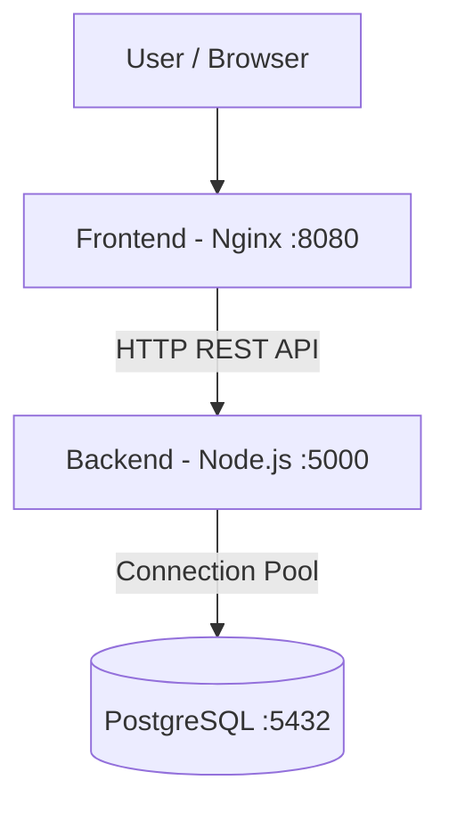

# LoanTrack — Three-Tier Loan Management Application

LoanTrack is a containerized three-tier loan management application developed as part of a DevOps assignment. It demonstrates application containerization, database connectivity, persistent storage, Kubernetes orchestration, health monitoring, and deployment automation.

## 1. Architecture

The application consists of three components:

- **Frontend:** HTML, CSS, JavaScript, and Nginx.
- **Backend:** Node.js and Express REST API.
- **Database:** PostgreSQL.

### Architecture diagram



The frontend communicates with the backend over HTTP. The backend communicates with PostgreSQL using a connection pool. The frontend never connects directly to the database.

## 2. Technology Stack

| Component | Technology |
|---|---|
| Frontend | HTML, CSS, JavaScript |
| Web server | Nginx |
| Backend | Node.js, Express |
| Database | PostgreSQL 17 Alpine |
| Database driver | node-postgres (`pg`) |
| Containerization | Docker |
| Multi-container orchestration | Docker Compose |
| Container orchestration | Kubernetes |
| Local Kubernetes | Minikube |
| Configuration | ConfigMaps and Secrets |
| Persistent storage | Kubernetes PVC |

## 3. Prerequisites and Tool Versions

The following tools were used to develop and test LoanTrack:

| Tool | Version |
|---|---|
| Docker | 29.8.0 |
| Docker Compose | v5.5.1 |
| Node.js | v24.21.0 |
| npm | 11.19.0 |
| kubectl | v1.36.1 |
| Kustomize | v5.8.1 |
| Minikube | v1.39.0 |

**Development environment:** Windows 11, PowerShell, Docker Desktop, and Minikube.

### Required tools

- Docker Desktop
- Docker Compose
- Node.js and npm
- kubectl
- Minikube

### Verify installation

Run these commands to verify the installed versions:

```powershell
docker --version
docker compose version
node --version
npm --version
kubectl version --client
minikube version
```

## 4. Project Structure

```text
LoanTrack/
├── backend/
│   ├── src/
│   │   ├── config/
│   │   ├── controllers/
│   │   ├── routes/
│   │   ├── app.js
│   │   └── server.js
│   ├── Dockerfile
│   └── package.json
│
├── frontend/
│   ├── src/
│   ├── Dockerfile
│   └── nginx.conf
│
├── db/
│   ├── migrations/
│   │   └── 001_create_loans.sql
│   └── seeds/
│       └── 001_seed_loans.sql
│
├── k8s/
│   ├── namespace.yml
│   ├── backend-configmap.yaml
│   ├── backend-deployment.yaml
│   ├── backend-service.yaml
│   ├── frontend-deployment.yml
│   ├── frontend-service.yaml
│   ├── postgres-configmap.yml
│   ├── postgres-statefulset.yaml
│   └── secret.example.yaml
│
├── docker-compose.yml
├── .env.example
├── .gitignore
└── README.md
```

## 5. Application API

| Method | Endpoint | Description |
|---|---|---|
| GET | `/loans` | Retrieve all loans |
| POST | `/loans` | Create a new loan |
| GET | `/healthz` | Check backend process health |
| GET | `/readyz` | Check database connectivity |

### Database schema

The `loans` table contains:

- `id` — Primary key
- `borrower_name` — Borrower's name
- `loan_amount` — Loan amount
- `property_city` — Property location
- `status` — Loan status
- `created_at` — Record creation timestamp

## 6. Running with Docker Compose

### Prerequisites

- Docker Desktop
- Docker Compose

### Step 1: Clone the repository

```powershell
git clone https://github.com/divyanshugsn/LoanTrack.git
cd LoanTrack
```

### Step 2: Configure environment variables

```powershell
Copy-Item .env.example .env
```

Update `.env` with your local configuration.

### Step 3: Start the application

```powershell
docker compose up -d --build
```

### Step 4: Verify containers

```powershell
docker compose ps
```

### Step 5: Access the application

Open:

http://localhost:8080

### Step 6: Stop the application

```powershell
docker compose down
```

The named PostgreSQL volume preserves database data.

To remove containers and the database volume:

```powershell
docker compose down -v
```

**Warning:** The `-v` option deletes the persisted database volume.

## 7. Running with Kubernetes (Minikube)

### Prerequisites

- Docker Desktop
- Minikube
- kubectl

### Step 1: Start Minikube

```powershell
minikube start
```

### Step 2: Build and load application images

```powershell
docker build -t loantrack-backend:v1 ./backend
docker build -t loantrack-frontend:v1 ./frontend

minikube image load loantrack-backend:v1
minikube image load loantrack-frontend:v1
```

### Step 3: Create the namespace

```powershell
kubectl apply -f k8s/namespace.yml
```

### Step 4: Create database credentials

Create the actual Kubernetes Secret locally:

```powershell
kubectl create secret generic postgres-secret `
  --from-literal=POSTGRES_PASSWORD='YOUR_PASSWORD' `
  -n loantrack
```

Never commit actual credentials or apply dummy credentials as production credentials.

### Step 5: Create the database initialization ConfigMap

```powershell
kubectl create configmap postgres-init-sql `
  --from-file=001_create_loans.sql=./db/migrations/001_create_loans.sql `
  --from-file=001_seed_loans.sql=./db/seeds/001_seed_loans.sql `
  -n loantrack
```

### Step 6: Apply database resources

```powershell
kubectl apply -f k8s/postgres-configmap.yml
kubectl apply -f k8s/postgres-statefulset.yaml
```

Wait for PostgreSQL:

```powershell
kubectl rollout status statefulset/postgres -n loantrack
```

### Step 7: Apply backend resources

```powershell
kubectl apply -f k8s/backend-configmap.yaml
kubectl apply -f k8s/backend-service.yaml
kubectl apply -f k8s/backend-deployment.yaml
```

### Step 8: Apply frontend resources

```powershell
kubectl apply -f k8s/frontend-deployment.yml
kubectl apply -f k8s/frontend-service.yaml
```

### Step 9: Verify resources

```powershell
kubectl get all -n loantrack
kubectl get pvc -n loantrack
```

### Step 10: Access the frontend

```powershell
minikube service frontend -n loantrack
```

This opens the frontend through the Minikube service. Keep the terminal session open if Minikube creates a tunnel.

## 8. Kubernetes Design Decisions

### Why PostgreSQL StatefulSet?

PostgreSQL requires persistent storage and stable workload identity. A StatefulSet provides stable Pod identity and a dedicated PVC through `volumeClaimTemplates`.

This ensures database data survives PostgreSQL Pod recreation.

### Why ConfigMaps and Secrets?

- ConfigMaps store non-sensitive application configuration.
- Secrets store sensitive database credentials.
- Both are injected into containers using Kubernetes environment references.

Kubernetes Secret values are base64-encoded, not encrypted merely because they are stored in a Secret.

For production deployments, I would use encryption at rest, restrictive RBAC permissions, and an external secret manager such as HashiCorp Vault or a cloud-provider secret manager.

### Why liveness and readiness probes?

- **Liveness probe:** Checks whether the application process is healthy. If it repeatedly fails, Kubernetes restarts the container.
- **Readiness probe:** Checks whether the application is ready to receive traffic. If it fails, Kubernetes removes the Pod from Service endpoints without restarting it.

The backend uses `/healthz` for liveness and `/readyz` for readiness. The readiness endpoint also verifies database connectivity.

### Why resource requests and limits?

Resource requests help Kubernetes schedule workloads based on available CPU and memory. Limits restrict the maximum resources a container can consume.

- **CPU limit exceeded:** The container is throttled and receives less CPU time. It is not normally terminated just because it exceeds its CPU limit.
- **Memory limit exceeded:** The container can be terminated by the kernel with an `OOMKilled` status. Kubernetes may restart it depending on the Pod's restart policy.

**Memory limit — OOMKilled**

When a container exceeds its memory limit, the Linux kernel can terminate its process through an Out Of Memory (OOM) kill.

Kubernetes reports the termination reason as OOMKilled.

The container may restart depending on the Pod's restart policy.

Users may experience failed requests while the application restarts.

### Backend Base Image Choice

The backend uses a Node.js Alpine-based image to keep the container lightweight, reduce the image footprint, and provide the Node.js runtime required by the Express application.

The base image is version-pinned to improve build reproducibility and consistency.

### Docker Layer-Caching Strategy

The Dockerfile copies dependency manifests (`package.json` and the lockfile) before installing dependencies and copying the remaining application source code.

This creates a reusable dependency-cache boundary. When only application source files change, Docker can reuse the dependency installation layer instead of reinstalling packages, reducing build time.

 **Why Base64 in Kubernetes Secrets Is Not Encryption**

Kubernetes Secrets use Base64 encoding to represent data as text.

However, Base64 is encoding, not encryption.

For example, consider this password:

mysecretpassword

Its Base64 representation is:

bXlzZWNyZXRwYXNzd29yZA==

Anyone can decode this value without a secret key.

Example using PowerShell:

[System.Text.Encoding]::UTF8.GetString(
    [System.Convert]::FromBase64String("bXlzZWNyZXRwYXNzd29yZA==")
)

Output:

mysecretpassword

Therefore, Base64 encoding does not provide confidentiality or protect credentials from unauthorized access.

A Kubernetes Secret can be retrieved by users with sufficient permissions:

kubectl get secret postgres-secret -n loantrack -o yaml

Kubernetes Secret objects should therefore be protected using appropriate access controls and encryption.

## 9. Database Persistence

PostgreSQL uses persistent storage.

In Docker Compose, a named volume preserves data across container recreation.

In Kubernetes, a PersistentVolumeClaim provides persistent storage for PostgreSQL.

Deleting a PostgreSQL Pod does not delete its PVC or the data stored in the associated volume.

## 10. Security Considerations

- `.env` files are excluded from Git.
- Actual Kubernetes Secret manifests are excluded from Git.
- `.env.example` contains dummy configuration values.
- `secret.example.yaml` provides a reference for creating the actual Kubernetes Secret.
- Frontend containers do not receive database credentials.
- Production deployments should use a dedicated secret-management solution.

## 11. Troubleshooting

Useful Kubernetes commands:

```powershell
kubectl get pods -n loantrack
kubectl describe pod <pod-name> -n loantrack
kubectl logs <pod-name> -n loantrack
kubectl get services -n loantrack
kubectl get pvc -n loantrack
kubectl get endpoints -n loantrack
```

For Docker Compose:

```powershell
docker compose ps
docker compose logs
docker compose logs backend
docker compose logs postgres
```

## 12. Cleanup

Remove Kubernetes resources:

```powershell
kubectl delete namespace loantrack
```

Stop Minikube:

```powershell
minikube stop
```

Remove Docker Compose resources:

```powershell
docker compose down
```

---

**Repository:** https://github.com/divyanshugsn/LoanTrack